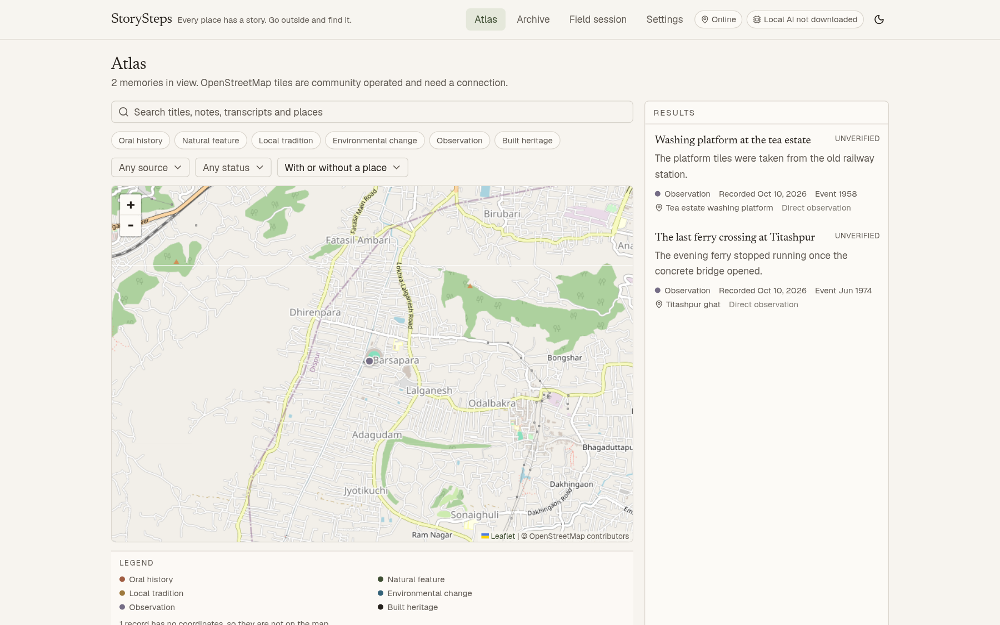
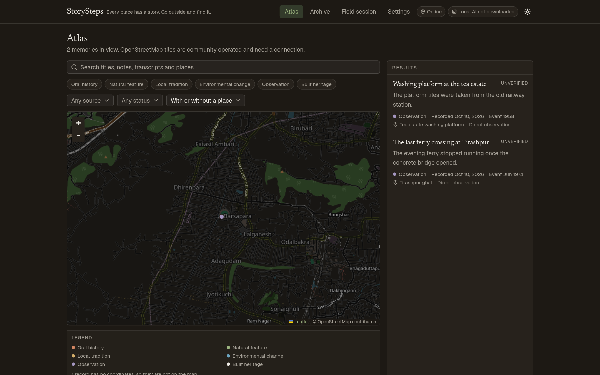
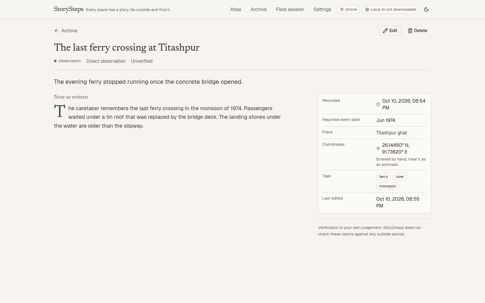
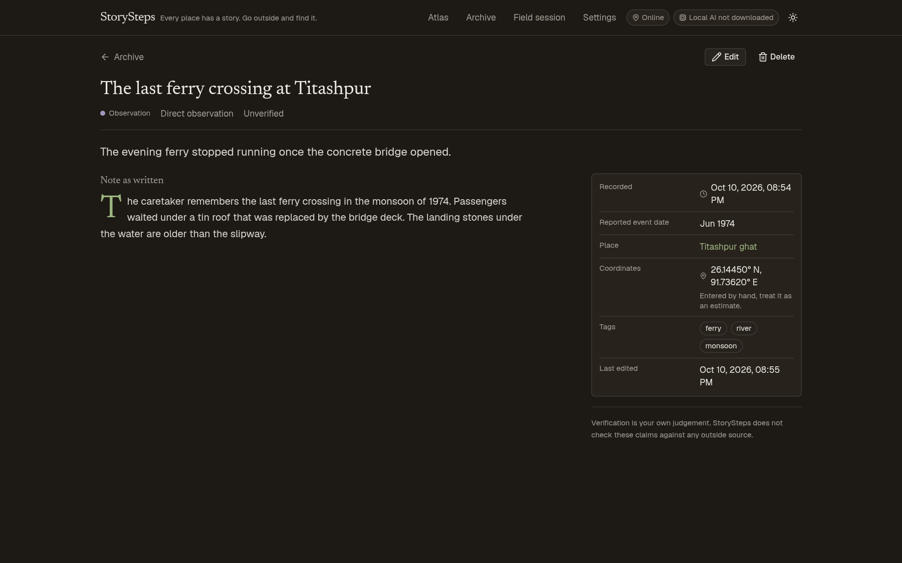
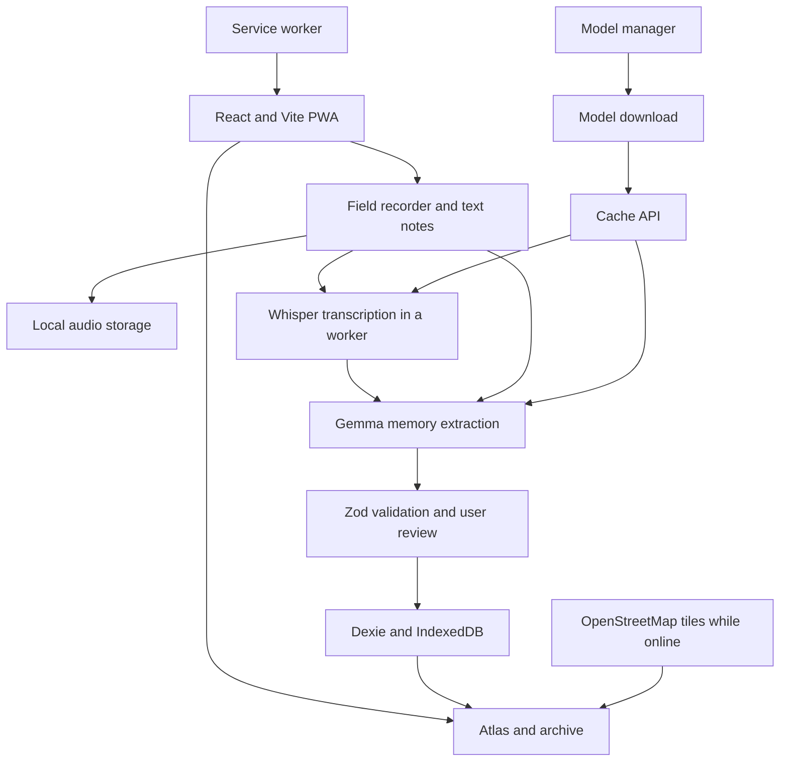
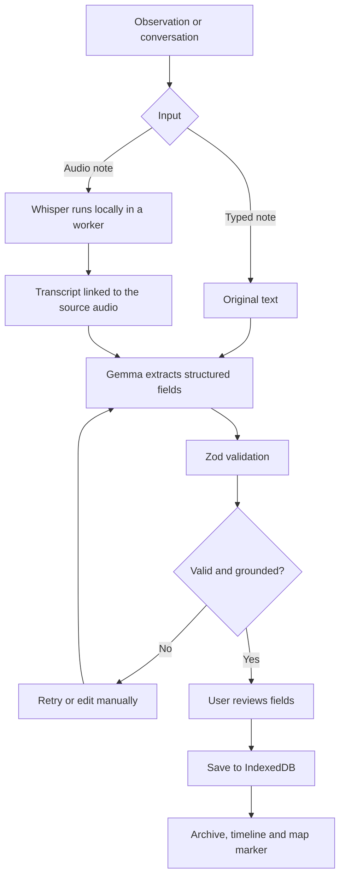

<p align="right"></p>

# StorySteps

Every place has a story. Go outside and find it.

StorySteps turns walks, conversations and observations into an atlas of local memories: oral histories, disappearing
landmarks, local traditions and environmental change. You record a note or a conversation, and it becomes an archive
record attached to a place and a date.

Everything stays on your device. There is no account, no server, no analytics and no remote AI. The models that
transcribe and structure your notes run in your own browser.

## The problem

Local knowledge is fragile. A village elder describes where the old crossing used to be, a mason explains which stones
were reused from the railway station, someone notices the last banyan at a crossing is gone. Most of it is written
down in a notebook, or not at all, and within a few years the details are gone with the people who held them.

StorySteps is a notebook that keeps the record tidy: what was said, who said it, roughly when it happened, where, and how
sure you are. It runs on the phone in your pocket, works without a signal, and leaves the archive with you in a JSON
file whenever you want it.

## A memory becoming an archive entry

On a walk through the old town you stop at a set of stone steps behind the old post office. A resident tells you that
her grandmother cut through there on the way to the market, and that the steps were worn smooth on one side. You open
a field session, start a recording, and ask permission before you press record.

Back at the steps you press record, speak for a minute, and stop. The audio is stored on the device. You transcribe it
with the local Whisper model, read the transcript, and correct two words. You type a short summary, set the category to
built heritage, type "1998" in the event date field because the speaker was unsure, and press Use my current location.
The map picks up the point you are standing at and marks it as coming from your device.

When the Gemma model is downloaded, you can let it suggest a title, a category and tags from the transcript. You read
every field and correct what it gets wrong, because the model is a filing assistant, not a historian. Saving writes a
record to IndexedDB. It appears in the archive, on the map, and on the timeline for that place, where the date you
recorded it sits next to the date it reportedly happened.

## What works now

- Create, edit, search, filter and delete memory records, entirely offline.
- Typed notes, transcripts, partial event dates with explicit precision, tags and source references.
- Field sessions that group several records from one walk, with notes that stay editable.
- Audio recording through MediaRecorder, playback of the stored file, and local transcription with Whisper.
- Atlas map with category markers, legend, filters and a results list that stays in sync with the map.
- Timeline per place showing recorded dates and remembered event dates side by side.
- Export to a versioned JSON archive, with audio as an explicit opt-in, and a validated transactional import.
- Separate deletion for records, for audio and for downloaded models.
- Light and dark themes, with a toggle in the header.
- Installable PWA with an offline app shell after the first visit.

## What is not here yet

- No Gemma inference has been run end to end on the machine this was built on. The code path exists, the self-hosted
  runtime loads, but the browser used for testing has no working WebGPU adapter. See "Browser requirements" below.
- No clustering of markers. The map is fine at the scale of a few hundred records; if that changes, clustering is the
  obvious next step.
- No text to speech, no embeddings, no vector search, no second language model.
- No sharing or sync of any kind. Records leave the device only through the export file you choose to save.

## Screenshots

These are real screenshots of this build, taken in a headless Chromium against the production bundle. The toggle in the
header switches between the two themes, and the choice is remembered on this device.

| Atlas, light | Atlas, dark |
| --- | --- |
|  |  |

| Memory record, light | Memory record, dark |
| --- | --- |
|  |  |

## Tech stack

React 19, Vite 8, TypeScript, Tailwind CSS v4, shadcn/ui components on Base UI, React Router 7, Dexie over IndexedDB,
Leaflet with OpenStreetMap tiles, LiteRT-LM for Gemma, `@huggingface/transformers` for Whisper, Zod at every boundary,
`vite-plugin-pwa` for the offline shell.

## Architecture



Data flow for a single memory:



## Prerequisites

- Node.js 22.12 or newer. This was built and tested on Node 26.7.0.
- pnpm 11 (the repository ships a `pnpm-lock.yaml`; do not switch package managers).

## Running it locally

```bash
pnpm install
pnpm run dev
```

The app is then on the URL Vite prints, normally `http://localhost:5173`. No API key, no environment file, no backend.

Other scripts:

```bash
pnpm run build     # typecheck, then a production build into dist/
pnpm run preview   # serve the production build locally
pnpm run lint      # eslint over the whole project
pnpm run test      # vitest, in-memory IndexedDB via fake-indexeddb
```

## Models

Two models are used, and neither is required to write, edit, search or export anything.

| Model | Size | Fetched when |
| --- | --- | --- |
| Gemma 4 E2B, web build (`gemma-4-E2B-it-web.litertlm`) | about 1.9 GB (2,008,432,640 bytes) | when you press Download model in Settings |
| Whisper base, quantised ONNX (`onnx-community/whisper-base`) | about 76 MB, plus about 26 MB for the ONNX runtime | the first time you transcribe a recording |

Both come from Hugging Face. Gemma is streamed into the Cache API under the cache name `storysteps-models-v1`, which
means the file survives reloads and works offline. The Gemma file is handed to LiteRT-LM as a stream, so the browser
never holds two copies of a 1.9 GB file in memory. Whisper caches its own files through the Cache API under
`transformers-cache`.

Deleting a model: Settings has Delete model from this device next to the download controls, and Delete models in the
data section. Both remove the cached files. If the browser clears site data on its own, StorySteps notices that the file
is gone and offers the download again rather than pretending the model is ready.

The LiteRT-LM runtime and the ONNX runtime are served from this origin under `/runtime/litert` and `/runtime/ort`
rather than from a CDN, so local AI keeps working when the network disappears. They total roughly 80 MB and are cached
by the service worker on first use.

## Browser and GPU requirements

Everything except local AI works in any current Chromium, Firefox or Safari with IndexedDB.

Local AI needs WebGPU. StorySteps checks this properly, by asking `navigator.gpu.requestAdapter()` for a real adapter,
not by testing whether the `navigator.gpu` property exists.

What was actually tested during development, in a headless Chromium 152 on Linux:

- Typed memories, search, filters, editing, deletion, export, import, persistence across reloads, offline startup:
  passed.
- Whisper base transcription on the WASM path, with the real model: passed. An 11 second speech sample was
  transcribed correctly in about 13 seconds including the first-time model download, and in about 3 seconds once the
  model was cached.
- Whisper transcription with every non-localhost request blocked, to prove it reads from cache and needs no network:
  passed.
- Gemma: not verified. `navigator.gpu` exists in that browser but `requestAdapter()` returns null, so LiteRT-LM cannot
  create its WebGPU device. The self-hosted LiteRT-LM runtime itself was verified to load in about 90 ms. The 1.9 GB
  model was not downloaded during testing, so the full load-and-generate path, the model manager progress display and
  the extraction review screen are implemented but unproven on real hardware. Test them on a machine with a working
  WebGPU adapter before relying on them.

LiteRT-LM runs on the main thread, so the interface can pause while Gemma loads or writes a response. Whisper runs in a
Web Worker and stays off the main thread.

## Online and offline behaviour

| Feature | Offline |
| --- | --- |
| Read, search and edit records | Works |
| Create typed memories | Works |
| Play back a stored recording | Works |
| Transcribe a recording | Works once Whisper has been downloaded |
| Extract fields with Gemma | Works once the Gemma model has been downloaded |
| Export and import archives | Works |
| Map tiles | Need a connection |

The map is the one part that genuinely needs the internet. Tiles come from the OpenStreetMap standard layer, which is
community operated and covered by its usage policy; StorySteps neither bulk-downloads nor pre-caches those tiles. When
tiles cannot load, the map shows an unobtrusive notice and the saved records stay visible in the results list beside
it. Anything already in your browser cache may still appear.

## Where your data lives

Everything is written to IndexedDB in this browser profile: `memories` for the text records, `audioAssets` for the
recordings, `fieldSessions`, `appSettings` and `modelStatus` for metadata about the models. The only thing written to
localStorage is your light or dark preference. Nothing about a record is ever sent anywhere.

Export writes a JSON file named `storysteps-archive-<timestamp>.json` containing the format name, a version, an export
timestamp and every record. Audio is base64 encoded inside the same file and is only included if you tick the box,
because it makes the file much larger. Import validates every field and the schema version before a single row is
written, previews how many records are new and how many already exist, and applies the whole import in one
transaction, so a malformed or half-supported file leaves the archive exactly as it was.

Deletion is separated on purpose: a memory can be deleted while keeping its recording, the archive can be wiped without
touching the downloaded models, and the models can be deleted without touching a single record.

## Privacy, and its limits

Local-first is a technical property here, not a promise: there is no code path that sends a transcript, a coordinate or
a recording to a third party, and no hosted model is used as a fallback when local inference is unavailable.

It is worth being clear about what local-first does not give you:

- Browser storage is not encrypted. Anyone with access to this browser profile, or to the device, can read these
  records.
- The browser can clear site data at any time. Settings can ask for persistent storage, and shows whether the browser
  granted it, but the request can be refused and the guarantee is not absolute.
- The export file is an ordinary file wherever you save it.
- When you record someone else, ask them first and tell them what you plan to do with the recording. StorySteps shows
  this reminder next to the record button and never publishes anything.

## Troubleshooting

**Local AI says WebGPU is unavailable.** Open `chrome://gpu` or the equivalent and check whether WebGPU is enabled. On
Linux, Chrome often needs `--enable-unsafe-swiftshader` or a working Vulkan driver. Notes, archive and export still
work without it.

**The model download fails or is cancelled.** The Gemma file is about 1.9 GB, so it needs free disk space and a
connection that will not drop. If the browser reports a quota error, delete some records or models first. If the
download is interrupted, nothing is written to the cache and you can simply press the button again.

**The browser clears models.** Storage pressure can evict cached files. StorySteps shows the model as not downloaded
again; press Download model to fetch it once more.

**Transcription is slow or inaccurate.** Whisper uses WebGPU when a real adapter answers, and falls back to the
processor automatically if the graphics path cannot start, in which case it says so underneath the button. The WASM
path is single threaded and takes roughly the length of the recording, or a little more. Accuracy depends on the model
size, the language, the accent and the background noise. Read the transcript before saving it. Short or silent
recordings are rejected instead of being turned into invented text.

**The microphone is blocked or unavailable.** Permission is requested only when you press Start recording, and typing
is always available. A denied permission never stops you writing notes.

**The map is blank.** Check the connection first. If tiles fail, a notice appears over the map and the records are
still listed. If the map is blank but the notice does not appear, try zooming, then reload.

**The offline update prompt never goes away.** A new build is waiting behind the service worker. Press Reload to
activate it, or Later to keep using this version until the next reload.

## Tests

```bash
pnpm run test
```

The suite runs in Vitest with `fake-indexeddb` and covers the parts where correctness is not obvious from the code:
schema validation of dates and coordinates, record creation and update, deletion with and without audio, orphan audio
cleanup, archive search and filtering, the export and import round trip with audio, rejection of malformed archives
without touching existing data, the parsing of model output including fenced JSON, unusable dates and unknown
categories, and a check that the ONNX Runtime files served from this origin really expose the WebGPU entry point
before the app hands them to the transcription worker.

Everything else, including the map, recording, transcription, offline startup and the whole interface, was checked by
running the app in a browser rather than by unit tests.

## Licence

StorySteps itself, meaning the source in this repository, is released under the MIT licence. See [LICENSE](LICENSE).
That licence covers this project only. The components below keep their own terms.

## Licences and attribution

| Component | Licence | Notes |
| --- | --- | --- |
| StorySteps source | MIT | This repository, see `LICENSE` |
| React Leaflet | Hippocratic License 2.1 | Ethical Source licence, see the exception below |
| Leaflet | BSD-2-Clause | Map rendering |
| LiteRT-LM | Apache-2.0 | WASM runtime copied from the npm package at build time and served from this origin |
| ONNX Runtime Web | MIT | WASM runtime copied from the npm package at build time and served from this origin |
| Transformers.js | Apache-2.0 | Runs Whisper in the browser worker |
| Dexie | Apache-2.0 | IndexedDB access |
| Geist, Newsreader | SIL Open Font License 1.1 | Bundled as woff2 files through `@fontsource` |
| Zod, React, React Router, Next Themes, Sonner, Tailwind, Vite, Vitest, ESLint and the shadcn/ui tooling | MIT | Runtime and build tooling |
| lucide-react | ISC | Icons |
| OpenStreetMap tiles | Open Database License | Tiles are fetched at runtime, not redistributed; attribution is shown on the map |
| Gemma 4 E2B | Gemma terms, via `litert-community/gemma-4-E2B-it-litert-lm` | Downloaded at runtime by the user, never redistributed here |
| Whisper base ONNX export | Apache-2.0, via `onnx-community/whisper-base` | Downloaded at runtime by the user |

### The React Leaflet exception

React Leaflet 5.0.0 is licensed under the Hippocratic License 2.1 rather than MIT. That is an Ethical Source licence: it
grants broad permissions but adds terms that MIT does not have, including a requirement to use the software in line with
human rights principles and laws, a termination clause, arbitration and an indemnity. Any build of StorySteps therefore
carries Hippocratic terms for the map user interface, while the rest of the project stays MIT.

This is a known and accepted trade-off here, because the alternative is maintaining a small hand written Leaflet wrapper.
If you fork this project and need a purely MIT dependency set, that wrapper is the only piece that needs replacing:
`src/components/atlas/AtlasMap.tsx` is the single file that touches React Leaflet.
